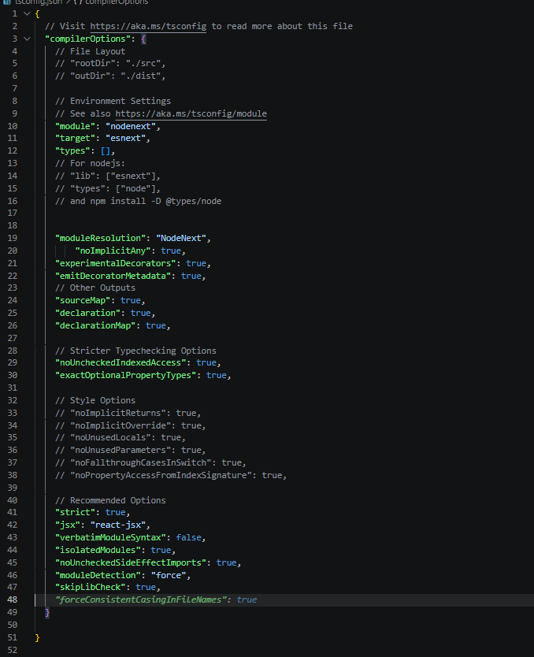
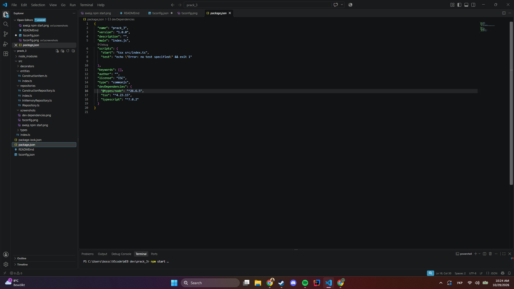
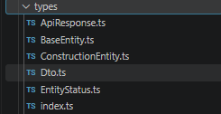
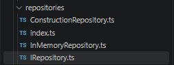
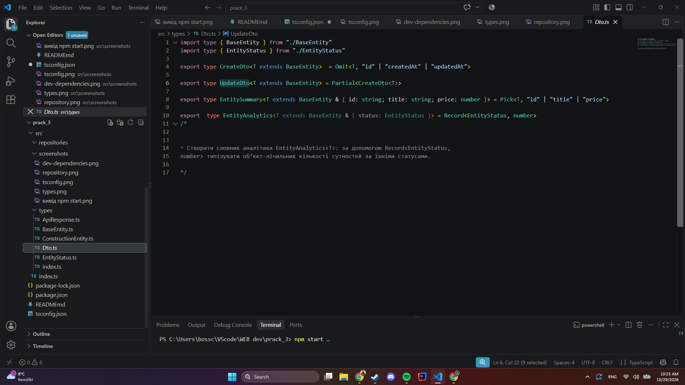
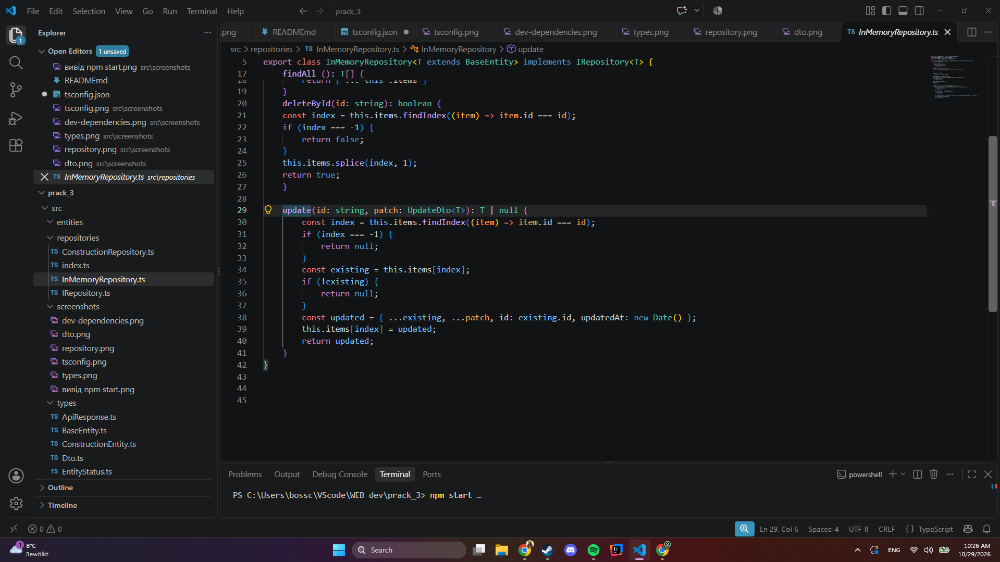
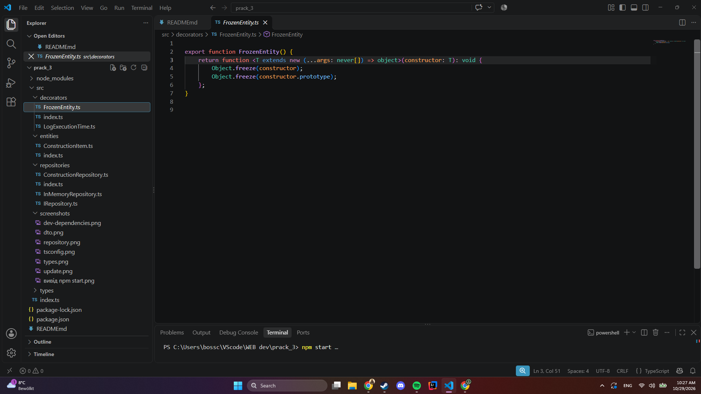
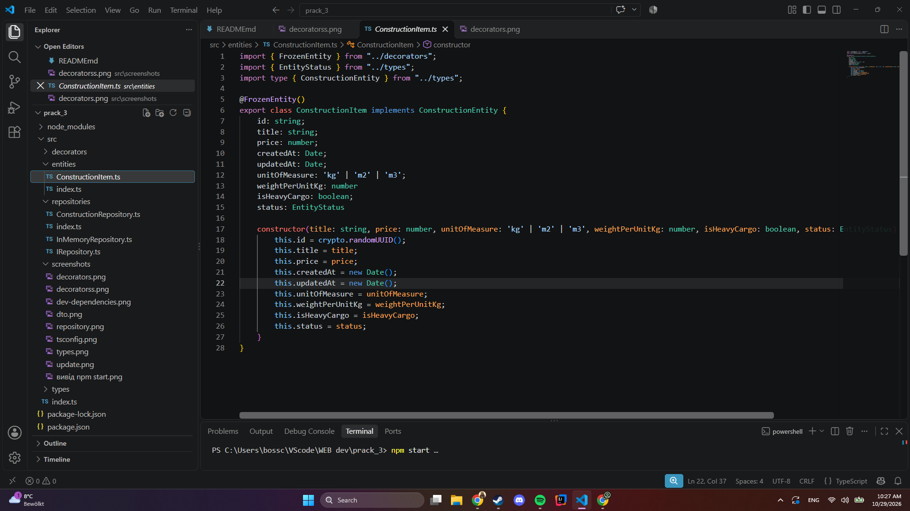
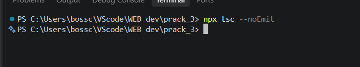

# Практична робота №3. Узагальнення, декоратори та утиліти типів TypeScript

**Виконав:** Григоряк Роман, група КН-42
**Варіант:** 6 (Будівельні матеріали, сутність `ConstructionEntity`)

## Опис

Модуль універсального сервісного шару та репозиторію в оперативній пам'яті (In-Memory Generic Repository & Service Layer) на TypeScript. Використано generics, utility types, enum, декоратори класу й методу та barrel files. Тип `any` не використовується.

## Структура проєкту

```
src/
├── types/          BaseEntity, ApiResponse, EntityStatus, ConstructionEntity, Dto
├── repositories/   IRepository, InMemoryRepository, ConstructionRepository
├── decorators/     LogExecutionTime, FrozenEntity
├── entities/       ConstructionItem
└── index.ts        демонстрація роботи
```

У кожній папці є `index.ts` (barrel file), який реекспортує її вміст.

## Запуск

```
npm install
npm start
```

Перевірка типів: `npx tsc --noEmit`

## Налаштування (tsconfig.json)

Увімкнено `strict`, `noImplicitAny`, `experimentalDecorators` та `emitDecoratorMetadata`. Залежності розробки: `typescript`, `tsx`, `@types/node`.




## Рівень 1. Generic-інтерфейси та репозиторій

- `BaseEntity` містить `id`, `createdAt`, `updatedAt`.
- `ApiResponse<TData>` є універсальною обгорткою відповіді: `success`, `data`, `timestamp`, `meta?`.
- `IRepository<T extends BaseEntity>` задає контракт: `create`, `findById`, `findAll`, `deleteById`, `update`. Обмеження `extends BaseEntity` гарантує наявність `id`.
- `InMemoryRepository<T>` реалізує контракт і зберігає дані в масиві `protected items: T[]`.




## Рівень 2. Utility Types та DTO

- `EntityStatus` є строковим enum: `ACTIVE`, `ARCHIVED`, `DRAFT`. Сутність має поле `status`.
- `CreateDto<T>` = `Omit<T, "id" | "createdAt" | "updatedAt">`: поля, які передає клієнт.
- `UpdateDto<T>` = `Partial<CreateDto<T>>`: будь-яка підмножина змінюваних полів.
- `EntitySummary<T>` = `Pick<T, "id" | "title" | "price">`: легкий витяг.
- `EntityAnalytics<T>` = `Record<EntityStatus, number>`: лічильник сутностей за статусами.
- Метод `update` оновлює `updatedAt` і зберігає незмінним `id`.




## Рівень 3. Декоратори та модульність

- `@LogExecutionTime()` є фабрикою декоратора методу. Через `PropertyDescriptor` підміняє `descriptor.value`, вимірює час через `performance.now()` і виводить `[BENCHMARK]`.
- `@FrozenEntity()` є декоратором класу: викликає `Object.freeze` на конструкторі та прототипі (захист від зміни під час виконання).
- Клас `ConstructionItem` позначений `@FrozenEntity()`.
- `ConstructionRepository` наслідує `InMemoryRepository<ConstructionEntity>`, методи `create`, `update`, `findAll` позначені `@LogExecutionTime()`.
- Barrel files у `types`, `repositories`, `decorators`, `entities` спрощують імпорти.





## Результат роботи

Перевірка типів без помилок:



Вивід програми (`npm start`):


## Відповіді на контрольні питання

**1. Що таке generics і яку проблему вони вирішують?**
Параметри типу дозволяють писати функції, інтерфейси й класи, що працюють з різними типами, зберігаючи повну статичну типізацію. На відміну від `any`, який вимикає перевірку, і `unknown`, який потребує звуження, generic зберігає конкретний тип: `InMemoryRepository<ConstructionEntity>` повертає саме `ConstructionEntity`.

**2. Як працює `extends` в обмеженнях?**
Він обмежує, які типи можна підставити. `T extends BaseEntity` означає, що `T` повинен мати поля `id`, `createdAt`, `updatedAt`. Тому всередині класу безпечно звертатися до `item.id`.

**3. Різниця між `Omit` і `Pick`.**
`Pick<T, K>` залишає лише вказані ключі, `Omit<T, K>` видаляє вказані ключі й залишає решту. `Omit` зручний для `CreateDto` (прибрати системні поля), `Pick` для коротких витягів (`EntitySummary`).

**4. Для чого `Partial<T>`?**
Робить усі поля необов'язковими. Для PATCH-запитів клієнт передає лише змінені поля, тому `UpdateDto` будується через `Partial`.

**5. Як працює `Record<K, V>`?**
Будує тип об'єкта з ключами типу `K` і значеннями типу `V`. Як `K` дозволені типи, що можуть бути ключами: `string`, `number`, `symbol`, їхні літеральні union та enum. У роботі `Record<EntityStatus, number>` вимагає наявності всіх трьох статусів.

**6. Що таке декоратор і які налаштування потрібні?**
Це функція, що додає анотації або змінює поведінку класу, методу, властивості чи параметра. Для експериментальних декораторів у `tsconfig.json` потрібні `"experimentalDecorators": true` та `"emitDecoratorMetadata": true`.

**7. Що таке `PropertyDescriptor` і як перехопити метод?**
Це об'єкт опису властивості, де `descriptor.value` містить оригінальну функцію методу. Декоратор зберігає її в `originalMethod`, підміняє `descriptor.value` новою функцією, яка виконує додаткову логіку (замір часу) й викликає `originalMethod.apply(this, args)`, після чого повертає результат.

**8. Що таке Barrel File і які його переваги?**
Це `index.ts` у каталозі, який реекспортує його публічні елементи. Імпорти стають короткими (`from "./repositories"`), внутрішня структура приховується, а при зміні файлів у модулі не потрібно правити імпорти по всьому проєкту. Це полегшує масштабування кодової бази.